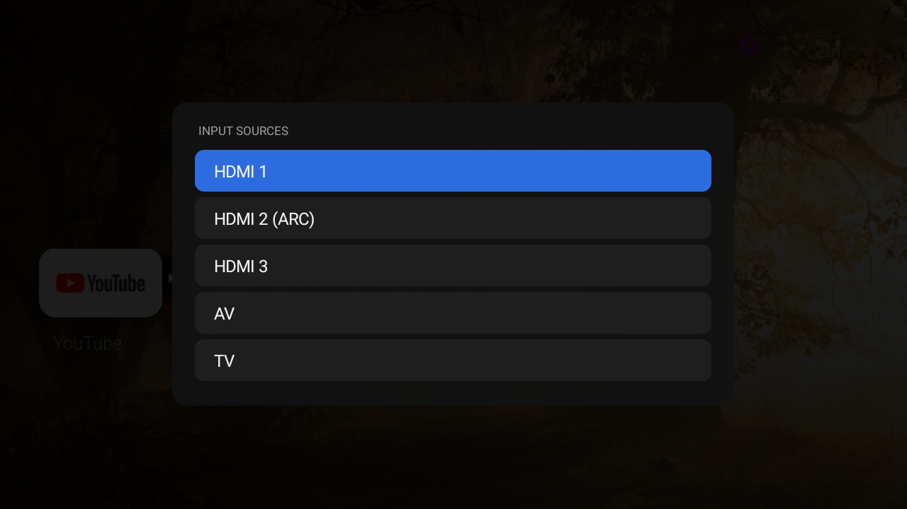
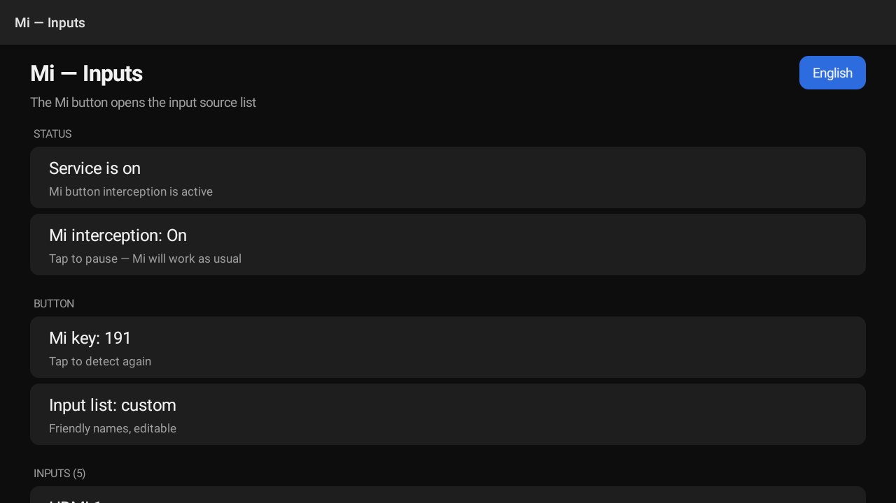

# Mi — Inputs

<p align="center">
  <a href="#mi--inputs"><kbd><b>English</b></kbd></a>
  &nbsp;
  <a href="#русская-версия"><kbd>Русский</kbd></a>
</p>

A small, root-free Android TV helper that turns the **Mi** button on a Xiaomi
remote into an **input-source picker** with human-readable names.

**Xiaomi only.** The Mi button exists only on Xiaomi remotes, so the app does
not work on TVs from other manufacturers. Tested on Xiaomi MiTV-MSSP0 (device
`amelie`, Android 9, build PI.4072) with PatchWall; other Xiaomi models may
work, but have not been tested — see [Scope](#scope).

No root, no bootloader unlock, no custom firmware, no factory reset — and
**no internet permission**. Everything can be rolled back.

> **AI-generated.** The application, its source code, and this documentation
> were created with AI assistance; the result was reviewed and tested on real
> hardware by a human.

## Screenshots



*The Mi button opens the input list.*



*Settings: service status, Mi key, pause, and the input list.*

## Features

- Intercepts the Mi key before the system handles it, so Live TV or PatchWall
  does not open; shows its own popup instead.
- Lists real inputs from the Android TV Input Framework: HDMI 1, HDMI 2 (ARC),
  AV, TV…
- Friendly names: edit any input, hide unused ones, reset to the system name.
- Re-detect the key — useful when another remote sends a different code.
- "System list" fallback that opens the vendor's own input popup.
- **Ports & inputs** diagnostics screen: what was found, how each HDMI port was
  numbered, and tap-to-test switching.
- **Pause interception**: Mi works as usual again; one tap to resume.
- English and Russian UI, English by default; language switcher in the header.
- No network access, no analytics; all settings are stored on the device.

## Tested on

| | |
|---|---|
| TV | Xiaomi MiTV-MSSP0 (device `amelie`) |
| Android | 9 |
| Build | PI.4072 (`Xiaomi/amelie/amelie:9/PI/4072:user/release-keys`) |
| Launcher | PatchWall |

## Requirements

- A Xiaomi TV with a Mi button on the remote (tested on MiTV-MSSP0 with
  PatchWall, Android 9). TVs from other manufacturers will not work.
- A way to sideload an APK (`adb install` or a file manager).
- Accessibility service enabled (on some firmware the accessibility screen is
  empty, so ADB is needed once).
- No root.

## Install

1. Download `Mi-Inputs-2.5.apk` from the **Releases** page of this repository
   (or build it yourself, see below).
2. Install it:

   ```bat
   adb install -r Mi-Inputs-2.5.apk
   ```

   > Play Protect may warn about an app installed outside Google Play. This is
   > expected for sideloaded APKs.

3. Open **Mi — Inputs** from the TV app list.
4. Enable the service:
   - **Service is on** — done.
   - **Service is off** — tap the row and enable **Mi — Inputs** in
     Accessibility.
   - If the accessibility list is empty (common on this firmware), use
     **How to enable** in the app or the ADB commands below.

### Enabling via ADB

```bat
adb shell settings put secure enabled_accessibility_services "com.tvsetup.mibutton/com.tvsetup.mibutton.MiKeyService"
adb shell settings put secure accessibility_enabled 1
```

If other accessibility services are already enabled, keep them and append ours
with a colon:

```bat
adb shell settings put secure enabled_accessibility_services "existing.pkg/existing.Service:com.tvsetup.mibutton/com.tvsetup.mibutton.MiKeyService"
adb shell settings put secure accessibility_enabled 1
```

Check that the service is bound:

```bat
adb shell dumpsys accessibility | findstr "Service["
```

You should see `Service[label=Mi — Inputs ...]`.

## First run

1. Open the app; the status should say **Service is on**.
2. Press **Mi** on the remote — the input list should appear.
3. If Live TV or PatchWall opens instead:
   - make sure interception is not paused (see below);
   - tap **Mi key: 191** and press Mi once; the app will remember the code.
4. Rename inputs: **INPUTS** → pick an input → preset name or **Reset to system
   name**.

## Pause

To let Mi behave as before without uninstalling the app or disabling the
service:

**STATUS → Mi interception: On** → tap.

The row becomes **Mi interception: Off**, the status shows "Interception is
paused", and Mi opens the stock Live TV or PatchWall again. Tap once more to
resume. The setting survives reboots and app restarts; the accessibility
service stays enabled.

## Language

The app name is always **Mi — Inputs** (launcher, Recents, accessibility list).
The UI is **English by default**, regardless of the TV language.

The switcher is in the header, to the right of the title: a small button with
the current language (`English` / `Русский`). Only these two languages are
available. The choice applies to every screen (settings, Ports & inputs, popup,
toasts) and is stored on the device. Preset input names are inserted in the
language that was active when you renamed the input.

## Inputs and ports

**Ports & inputs** shows what the app actually sees:

```
Found 5: HDMI 3 · AV 1 · TV 1

HDMI 1
HDMI · port HDMI 1 (from system label)
system label: HDMI 1
com.mediatek.tvinput/.hdmi.HDMIInputService/HW2
```

HDMI port number priority:

1. digits from the system label (`HDMI 2(ARC)` → 2);
2. digits from the input id (e.g. `HDMI2InputService`);
3. the next free number in hardware-port order.

Tap an input there to switch to it — handy for verifying each port.

Signal state is not available: `TvInputManager.getInputState()` and
`TvInputInfo.getHdmiDeviceInfo()` are hidden APIs. Check the picture after
switching.

## Names

Default names: `HDMI N` (plus `(ARC)` when present), `AV`, `TV`, `PC (VGA)`.
Presets: HDMI 1…4, AV, TV, PC, USB, Media player, Game console. **Reset to
system name** clears a custom name. Inputs can be hidden from the list.

## How it works

| | |
|---|---|
| Package | `com.tvsetup.mibutton` |
| Service | `com.tvsetup.mibutton/.MiKeyService` |
| Popup | `com.tvsetup.mibutton/.InputPopupActivity` |
| Default key | `191` (KEYCODE_BUTTON_2) |
| Inputs | `android.media.tv.TvInputManager` |
| Switching | `Intent.ACTION_VIEW` + `TvContract.buildChannelUriForPassthroughInput()` |
| Internet | not used (no `INTERNET` permission) |

The accessibility service requests `flagRequestFilterKeyEvents`, receives the
key before the system, and returns `true` to consume it. The app then shows its
popup and, on selection, sends the standard `ACTION_VIEW` passthrough intent —
the same mechanism the stock input list uses.

## Scope

The app is made for **Xiaomi TVs**: the Mi button exists only on Xiaomi remotes,
so it **does not work on TVs from other manufacturers** — there is no Mi button
to intercept.

Among Xiaomi models, only **MiTV-MSSP0** (device `amelie`, Android 9, build
PI.4072) with **PatchWall** has been tested. Other Xiaomi models may work, but
have not been tested and are not supported.

For another Xiaomi model to work, it needs:

- the Mi button to reach Android as a key event — on some remotes the button is
  sent directly over IR to a closed service, and then it cannot be intercepted;
- the Android TV Input Framework exposed by the firmware;
- on Android 13+, sideloaded apps allowed in "Restricted settings" before the
  accessibility service can be enabled.

The key can be re-detected on any Xiaomi remote. If the system does not expose
its inputs, set **Input list** to **Built-in TV list**; the app will open the
vendor's popup.

## Build from source

Requirements: Windows, Python 3, JDK 17, Android build-tools and `android.jar`
(API 28).

```bat
powershell -ExecutionPolicy Bypass -File build\build.ps1
```

The script looks for tools in this order: `-Jdk`/`-Tools`/`-PlatformJar` →
`JAVA_HOME`/`ANDROID_HOME` → `build\tools`.

- `-Jdk <dir>` — JDK (must contain `bin\javac.exe`)
- `-Tools <dir>` — Android build-tools (must contain `aapt2.exe`)
- `-PlatformJar <file>` — `android.jar` from platform API 28

On the first build a signing key is generated at `build\mibutton.keystore`
(alias `mibutton`, password `mibutton123`; override with `-StorePass`).
**Keep it**: Android only accepts updates signed with the same key. The key used
for the release APK is not published, so a build made with your own key cannot
update the released APK — uninstall the old version first.

Result: `dist\Mi-Inputs-2.5.apk`.

```
app\                 Java sources, manifest, resources
build\build.ps1      build script (aapt2 → javac → d8 → zipalign → apksigner)
build\inject.py      packs classes.dex into the APK
build\tools\         optional local JDK/build-tools/android.jar (not in the repo)
dist\                build output (not in the repo)
```

## Rollback

Keep only the other accessibility service (example):

```bat
adb shell settings put secure enabled_accessibility_services "com.spocky.projengmenu/com.spocky.projengmenu.services.ProjectivyAccessibilityService"
adb shell settings put secure accessibility_enabled 1
```

Full removal:

```bat
adb uninstall com.tvsetup.mibutton
adb shell settings put secure enabled_accessibility_services "com.spocky.projengmenu/com.spocky.projengmenu.services.ProjectivyAccessibilityService"
adb shell settings put secure accessibility_enabled 1
```

If the service list becomes empty, the firmware may reset `accessibility_enabled`
to `0` — that is expected.

## Troubleshooting

| Symptom | What to do |
|---|---|
| Mi opens Live TV or PatchWall | Check **Mi interception** is On; then tap **Mi key** and press Mi |
| Popup does not appear | Check **Service is on**; reboot the TV |
| Popup appears, input does not switch | **Input list** → **Built-in TV list** |
| An input is missing | **Refresh list**; make sure it is not hidden |
| Stopped working after a firmware update | Check the service and re-detect the key |

Logs: `adb logcat -s MiKeyService:I MiInputs:W`.

## Privacy

The app has no `INTERNET` permission. It does not collect or send anything.
Settings (key code, names, language, pause) are stored in SharedPreferences on
the device. The accessibility service only filters key events to find the Mi
key; it does not read screen content or text.

## Disclaimer

Not affiliated with Xiaomi. Use at your own risk: the app only changes which
screen opens on a key press and can be removed at any time. Android is a
trademark of Google LLC.

## License

MIT — see [LICENSE](LICENSE).

---

# Русская версия

<p align="center">
  <a href="#mi--inputs"><kbd>English</kbd></a>
  &nbsp;
  <a href="#русская-версия"><kbd><b>Русский</b></kbd></a>
</p>

Небольшое приложение для Android TV, которое превращает кнопку **Mi** на пульте
Xiaomi в **выбор источника входа** с понятными названиями.

**Только Xiaomi.** Кнопка Mi есть только на пультах Xiaomi, поэтому на
телевизорах других производителей приложение не работает. Проверено на Xiaomi
MiTV-MSSP0 (устройство `amelie`, Android 9, сборка PI.4072) с PatchWall; другие
модели Xiaomi могут работать, но не тестировались — см. «Область применения».

Без root, разблокировки загрузчика, перепрошивки и сброса — и **без доступа в
интернет**. Всё можно откатить.

> **Сгенерировано ИИ.** Приложение, его исходный код и эта документация созданы
> с помощью ИИ; результат проверен человеком на реальном телевизоре.

## Скриншоты


*Кнопка Mi открывает список входов.*


*Настройки: состояние службы, клавиша Mi, пауза и список входов.*

## Возможности

- Перехватывает кнопку Mi раньше системы: Live TV или PatchWall не открывается,
  вместо них появляется свой список входов.
- Берёт реальные входы из Android TV Input Framework: HDMI 1, HDMI 2 (ARC), AV,
  ТВ…
- Понятные названия: любой вход можно переименовать, ненужные — скрыть, имя —
  вернуть к системному.
- Клавишу можно определить заново — если на другом пульте другой код.
- Режим «системный список» — запасной вариант, открывает родной попап прошивки.
- Экран **«Порты и входы»**: что нашлось, как определён номер каждого HDMI, и
  проверка переключения нажатием.
- **Пауза перехвата**: Mi снова работает как обычно, включается одним нажатием.
- Интерфейс на английском и русском, по умолчанию английский; переключатель — в
  шапке.
- Нет доступа в сеть и аналитики; все настройки хранятся на телевизоре.

## Проверено на

| | |
|---|---|
| Телевизор | Xiaomi MiTV-MSSP0 (устройство `amelie`) |
| Android | 9 |
| Сборка | PI.4072 (`Xiaomi/amelie/amelie:9/PI/4072:user/release-keys`) |
| Лаунчер | PatchWall |

## Требования

- Телевизор Xiaomi с кнопкой Mi на пульте (проверено на MiTV-MSSP0 с PatchWall,
  Android 9). На телевизорах других производителей не работает.
- Возможность установить APK вручную (`adb install` или файловый менеджер).
- Включённая служба специальных возможностей (на некоторых прошивках список
  служб пустой, поэтому один раз нужен ADB).
- Root не нужен.

## Установка

1. Скачайте `Mi-Inputs-2.5.apk` со страницы **Releases** этого репозитория (или
   соберите сами — см. ниже).
2. Установите:

   ```bat
   adb install -r Mi-Inputs-2.5.apk
   ```

   > Play Protect может предупредить о приложении, установленном вне Google
   > Play. Для APK, скачанных вручную, это нормально.

3. Запустите **Mi — Inputs** из списка приложений на телевизоре.
4. Включите службу:
   - «Служба включена» — всё готово;
   - «Служба выключена» — нажмите на строку и включите **Mi — Inputs** в
     «Специальных возможностях»;
   - если список служб пустой (так бывает на этой прошивке) — пункт **«Как
     включить службу»** в приложении или команды ADB ниже.

### Включение через ADB

```bat
adb shell settings put secure enabled_accessibility_services "com.tvsetup.mibutton/com.tvsetup.mibutton.MiKeyService"
adb shell settings put secure accessibility_enabled 1
```

Если другие службы уже включены, сохраните их и добавьте нашу через двоеточие:

```bat
adb shell settings put secure enabled_accessibility_services "existing.pkg/existing.Service:com.tvsetup.mibutton/com.tvsetup.mibutton.MiKeyService"
adb shell settings put secure accessibility_enabled 1
```

Проверка, что служба поднялась:

```bat
adb shell dumpsys accessibility | findstr "Service["
```

В списке должна быть строка `Service[label=Mi — Inputs ...]`.

## Первый запуск

1. Откройте приложение; статус должен быть **«Служба включена»**.
2. Нажмите **Mi** на пульте — должен открыться список входов.
3. Если открылся Live TV или PatchWall:
   - проверьте, что перехват не на паузе (см. ниже);
   - нажмите строку **«Клавиша Mi: 191»** и нажмите Mi ещё раз: приложение
     запомнит код.
4. Названия: **«ВХОДЫ»** → выберите вход → готовое название или **«Вернуть
   системное название»**.

## Пауза перехвата

Чтобы Mi снова вела себя как до установки, не удаляя приложение и не выключая
службу:

**СОСТОЯНИЕ → «Перехват Mi: включён»** → нажать.

Строка сменится на **«Перехват Mi: выключен»**, статус — на «Перехват
приостановлен», а Mi начнёт открывать штатный Live TV или PatchWall. Повторное
нажатие возвращает перехват. Настройка переживает перезапуск приложения и
телевизора; служба специальных возможностей остаётся включённой.

## Язык интерфейса

Название приложения — всегда **Mi — Inputs** (иконка, «Недавние», список служб).
Интерфейс по умолчанию **английский**, независимо от языка телевизора.

Переключатель находится **в шапке, справа от названия**: небольшая кнопка с
текущим языком (`English` / `Русский`). Доступны только эти два языка. Выбор
применяется сразу ко всем экранам (настройки, «Порты и входы», попап,
сообщения) и сохраняется на телевизоре. Готовые названия входов вставляются на
языке, который был выбран в момент переименования.

## Входы и порты

Экран **«Порты и входы»** показывает, что приложение реально видит:

```
Найдено 5: HDMI 3 · AV 1 · ТВ 1

HDMI 1
HDMI · порт HDMI 1 (из системного названия)
системное название: HDMI 1
com.mediatek.tvinput/.hdmi.HDMIInputService/HW2
```

Номер HDMI-порта определяется по приоритету:

1. цифра из системного названия (`HDMI 2(ARC)` → 2);
2. цифра из идентификатора входа (например, `HDMI2InputService`);
3. свободный номер по порядку аппаратных портов.

Нажатие на вход в этом списке переключает на него — так можно проверить каждый
порт.

Есть ли **сигнал** на порту, приложение узнать не может: методы
`TvInputManager.getInputState()` и `TvInputInfo.getHdmiDeviceInfo()` скрыты.
Состояние сигнала проверяется визуально после переключения.

## Названия входов

По умолчанию: `HDMI N` (плюс `(ARC)`, если так было в системе), `AV`, `ТВ`,
`ПК (VGA)`. Готовые варианты: HDMI 1…4, AV, ТВ, ПК, USB, Медиаплеер, Игровая
консоль. **«Вернуть системное название»** сбрасывает переименование. Вход можно
скрыть из списка.

## Как это работает

| | |
|---|---|
| Пакет | `com.tvsetup.mibutton` |
| Служба | `com.tvsetup.mibutton/.MiKeyService` |
| Попап | `com.tvsetup.mibutton/.InputPopupActivity` |
| Клавиша | по умолчанию `191` (KEYCODE_BUTTON_2) |
| Входы | `android.media.tv.TvInputManager` |
| Переключение | `Intent.ACTION_VIEW` + `TvContract.buildChannelUriForPassthroughInput()` |
| Интернет | не используется (нет разрешения `INTERNET`) |

Служба специальных возможностей запрашивает `flagRequestFilterKeyEvents`,
получает клавишу раньше системы и возвращает `true` — событие поглощается.
Затем приложение показывает свой попап и по выбору отправляет штатный
`ACTION_VIEW` на passthrough-URI входа — тот же механизм, что у системного
списка.

## Область применения

Приложение сделано для **телевизоров Xiaomi**: кнопка Mi есть только на пультах
Xiaomi, поэтому на телевизорах других производителей оно **не работает** —
перехватывать нечего.

Среди моделей Xiaomi проверена только **MiTV-MSSP0** (устройство `amelie`,
Android 9, сборка PI.4072) с **PatchWall**. Другие модели Xiaomi могут
работать, но не тестировались и не поддерживаются.

Чтобы заработало на другой модели Xiaomi, нужно:

- кнопка Mi должна доходить до Android как событие клавиши — на некоторых
  пультах она шлёт ИК напрямую в закрытую службу, и тогда перехватить её нельзя;
- прошивка должна отдавать Android TV Input Framework;
- на Android 13+ сайдлоад-приложению должны быть разрешены «Ограниченные
  настройки», прежде чем включать службу специальных возможностей.

Клавишу можно определить заново на любом пульте Xiaomi. Если система не отдаёт
список входов, включите **«Список входов: системный»** — приложение откроет
родной попап прошивки.

## Сборка из исходников

Нужны Windows, Python 3, JDK 17, Android build-tools и `android.jar` (API 28).

```bat
powershell -ExecutionPolicy Bypass -File build\build.ps1
```

Скрипт ищет инструменты в таком порядке: `-Jdk`/`-Tools`/`-PlatformJar` →
`JAVA_HOME`/`ANDROID_HOME` → `build\tools`.

- `-Jdk <папка>` — JDK (должен содержать `bin\javac.exe`);
- `-Tools <папка>` — Android build-tools (должны содержать `aapt2.exe`);
- `-PlatformJar <файл>` — `android.jar` из платформы API 28.

При первой сборке ключ подписи создаётся автоматически в
`build\mibutton.keystore` (alias `mibutton`, пароль `mibutton123`; можно
переопределить через `-StorePass`). **Храните его**: Android принимает
обновления только с той же подписью. Ключ, которым подписан релизный APK, не
публикуется, поэтому сборка со своим ключом не сможет обновить релизный APK —
сначала удалите старую версию.

Результат: `dist\Mi-Inputs-2.5.apk`.

```
app\                 исходники Java, манифест, ресурсы
build\build.ps1      сборка (aapt2 → javac → d8 → zipalign → apksigner)
build\inject.py      упаковка classes.dex в APK
build\tools\         локальные JDK/build-tools/android.jar (нет в репозитории)
dist\                результат сборки (нет в репозитории)
```

## Откат

Оставить только другую службу (пример):

```bat
adb shell settings put secure enabled_accessibility_services "com.spocky.projengmenu/com.spocky.projengmenu.services.ProjectivyAccessibilityService"
adb shell settings put secure accessibility_enabled 1
```

Полное удаление:

```bat
adb uninstall com.tvsetup.mibutton
adb shell settings put secure enabled_accessibility_services "com.spocky.projengmenu/com.spocky.projengmenu.services.ProjectivyAccessibilityService"
adb shell settings put secure accessibility_enabled 1
```

Если список служб окажется пустым, прошивка сама сбросит
`accessibility_enabled` в `0` — это штатно.

## Если что-то не работает

| Симптом | Что делать |
|---|---|
| Mi открывает Live TV или PatchWall | Проверить, что «Перехват Mi» включён; затем нажать строку «Клавиша Mi» и нажать Mi |
| Попап не появляется | Проверить «Служба включена»; перезагрузить телевизор |
| Попап есть, вход не переключается | «Список входов» → «Системный список прошивки» |
| В списке нет входа | «Обновить список»; проверить, что вход не скрыт |
| Перестало работать после обновления прошивки | Проверить службу и определить клавишу заново |

Диагностика: `adb logcat -s MiKeyService:I MiInputs:W`.

## Приватность

У приложения нет разрешения `INTERNET`. Оно ничего не собирает и не отправляет.
Настройки (код клавиши, названия, язык, пауза) хранятся в SharedPreferences на
телевизоре. Служба специальных возможностей только фильтрует события клавиш,
чтобы найти Mi; содержимое экрана и текст она не читает.

## Отказ от ответственности

Проект не связан с Xiaomi. Используйте на свой риск: приложение лишь меняет,
что открывается по нажатию кнопки, и удаляется в любой момент. Android —
торговая марка Google LLC.

## Лицензия

MIT — см. [LICENSE](LICENSE).
